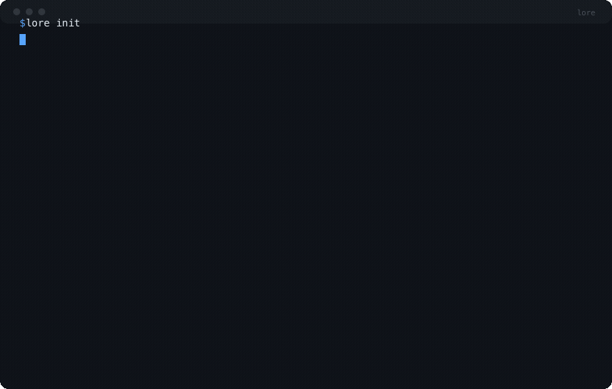
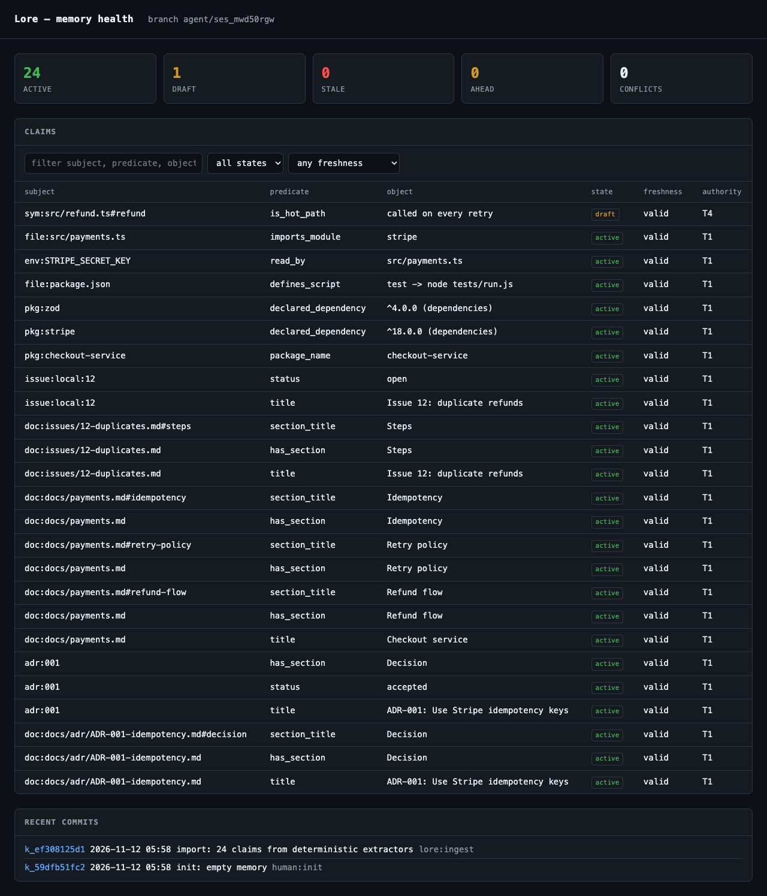
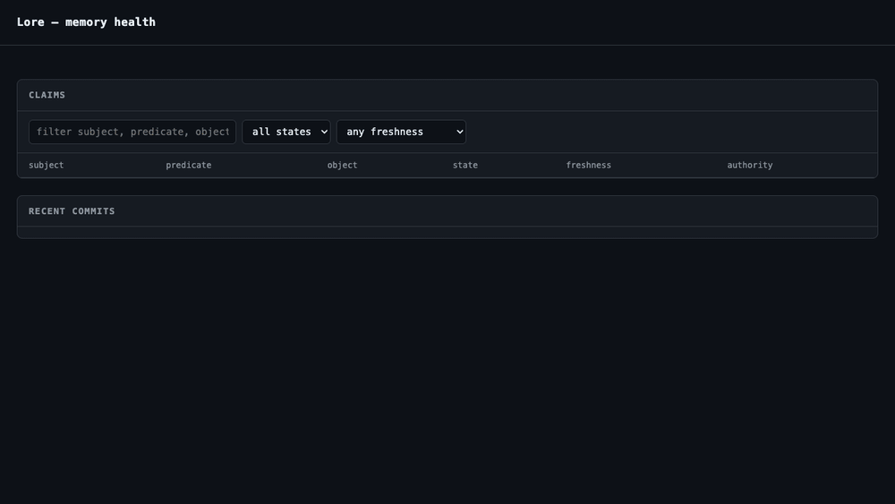

#  Lore

**Git for what your AI agents know.**

Lore is a memory layer for AI coding agents: claims with provenance, stale detection,
parallel-agent merges, and undo for a bad session.

[](https://github.com/529-studio/lore/actions/workflows/ci.yml)
[](LICENSE)
[](package.json)

---

## The problem

If you use more than one AI agent on the same project (Claude Code, Codex, Gemini CLI, Cursor),
their memory today is an append-only log with vector search. It stores, but nobody trusts it:

1. **Dead facts keep living.** The file changed three weeks ago; the memory still describes the old behaviour.
2. **Contradictions are both "true".** Two agents learned different things; search returns both.
3. **You cannot undo a bad session.** Memory that was poisoned stays poisoned.
4. **You cannot ask "who taught the agent this?"** So you never dare rely on it.
5. **Agent B does not trust agent A**, so it redoes the work.

Lore fixes the **trust** problem, not the storage problem.

## What it gives you

| Guarantee | How |
|---|---|
| **Provenance** | Every claim carries evidence with a content hash and an authority tier (T0 test → T4 inference) |
| **Staleness** | On read, evidence is re-hashed; a claim whose file changed is marked stale and drops out of retrieval |
| **Trust** | Only `active` + `canonical` claims are injected; contested facts are withheld with a warning |
| **Merge** | 3-way merge on `(subject, predicate)` with a deterministic ladder; unresolvable conflicts abort instead of guessing |
| **Undo** | `lore revert` writes an inverse commit. History is never rewritten, so `blame` still works |

## See it work



**Canon demo:** [npm → pnpm invalidation](scripts/demo/canon-pnpm.sh).

**GUI:** `lore ui` serves a live dashboard; see [docs/desktop.md](docs/desktop.md).





## 60-second demo

```bash
npm i -g @529studio/lore        # or a Release tarball

cd my-project
lore init                       # creates .lore/ + lore.ontology.yml
lore ingest                     # derives claims from manifests, env vars, imports, routes, rules
lore status                     # 77 active, 0 draft, 0 stale
lore search "DATABASE_URL"      # ranked claims with evidence and score breakdown
lore blame env:DATABASE_URL     # who/what taught this, and whether it is still true
```

Then edit a file that a claim depends on:

```bash
lore status                     # stale 10  (nothing is deleted)
lore verify --all --strict      # exit 3 — memory health is a CI gate
```

---

## Who this is for

For developers using coding agents on a repository (Node 22+, git). Non-terminal: [Track B](#track-b--non-terminal-setup).

---

## Track A — developer setup

### Prerequisites

- **Node.js 22+**
- **git** (drives extraction; memory lives beside the repo)
- An MCP-capable client: Claude Code, Codex CLI, Gemini CLI, Cursor, or any MCP-over-stdio client.

### Install

```bash
# npm (recommended)
npm i -g @529studio/lore

# or build from source
git clone https://github.com/529-studio/lore.git && cd lore
npm ci && npm run build && npm link
```

Verify: `lore --version`.

### Initialise a repository

```bash
cd my-project
lore init
```

Creates:

```
.lore/lore.db          # SQLite store: claims, evidence, commits, refs
lore.ontology.yml      # which predicates may hold one value vs many
.gitignore             # .lore/ appended, so the store is not committed
```

`lore ingest` derives claims deterministically (no LLM):

| Source | Claim example |
|---|---|
| manifests | `pkg:zod — declared_dependency — ^4.0.0`, from package.json, requirements*.txt, pyproject.toml or go.mod at any depth |
| env vars | `env:DATABASE_URL — read_by — src/db.ts` |
| imports | `file:src/api.ts — imports_module — zod`; `file:backend/app.py — imports_module — django.db` |
| routes | `file:src/routes.ts — exposes_route — GET /health` |
| in-code invariants | `file:src/db.go#L42 — enforces_invariant — Hand-written SQL only` |
| ADR decisions | `adr:001 — decides — Store memory in a single SQLite file` |
| lesson rules | `lesson:L04 — defines_rule — When a shared helper is the fix...` |
| rule registries | `rule:MCP-001 — detects — Remote endpoint uses plain HTTP` |
| root docs | `doc:README.md — has_section — Quick start` |

Re-running `ingest` is idempotent.

### Connect your agents (MCP)

Run `lore setup` to configure your agent automatically:

```bash
lore setup agy        # Antigravity CLI (.agents/mcp_config.json)
lore setup claude     # Claude Code (.mcp.json)
lore setup codex      # Codex CLI (.codex/config.toml)
lore setup gemini     # Gemini CLI (~/.gemini/settings.json)
lore setup cursor     # Cursor IDE (.cursor/mcp.json)
lore setup opencode   # OpenCode (opencode.json)
```

Or configure manually: `claude mcp add lore --scope project --env LORE_SESSION=claude -- node "$(command -v lore)" mcp`.

Each client sets its own `LORE_SESSION` (a branch `agent/<session>`); agents never write to `main`.
Full details: [docs/mcp.md](docs/mcp.md).

### Daily workflow

| When | Command | Why |
|---|---|---|
| Start of a task | `lore search "<task>" --files src/x.ts` | give the agent the right 10 claims instead of the whole repo |
| During the task | agent calls `memory_write` | inference lands as `draft`, not trusted yet |
| End of the task | `lore status` → `lore approve <id>` | you review what the agent learned |
| Hand-off | `lore promote` | merge your branch into `main` so other sessions inherit it |
| Something is wrong | `lore blame <subject>` / `lore revert <commit>` | trace it, then undo it |

### Command reference

```
lore init [--solo] [--full]    initialise .lore/ (--full: rules, ingest, MCP)
lore ingest [--dry-run]        derive claims from deterministic extractors
lore write                     write one claim (draft for agent/human); --valid-from <iso>
lore search "<query>"          rank rules over static facts; --files, --semantic, --valid-at
lore explain <claim|key>       why a claim is injected: trust, provenance, evidence
lore canon status|decay|confirm|resolve|metrics  trust, decay, re-confirm, resolve, metrics
lore blame <subject>           provenance: author, evidence, branch membership
lore timeline <subject>       bi-temporal revisions across valid-time and tx-time
lore status [--strict]         health: branch and store active/draft/stale, conflicts, GC
lore diff <from>..<to>         claims added/removed between revisions
lore merge <branch>           3-way merge; --semantic, exit 2 on real conflicts
lore resolve [s] [p]          record conflict decision; --take, --auto-semantic
lore promote                   merge current branch into main
lore push --propose            publish session branch + drafts as a hub proposal
lore proposals | review --remote  review, approve, promote proposals to main
lore wrapup [--yes]            audit session drafts, approve and promote
lore revert <commit>           inverse commit, history preserved
lore verify <claim> | --all    re-hash evidence; --accept stores a legitimate change
lore guard [--staged]         scan for secrets before they enter a claim
lore identity [issue]         show identity or issue a token
lore alias add <name> <id>    name an entity ("refund flow" -> doc:...#refund-flow)
lore rename <old> <new>       move entities and evidence after a file rename
lore onboard                  detect the stack, pick a template, ingest
lore review                   review drafts one by one (approve / reject / skip)
lore reject <claim>           reject a draft: retract it, keep the row and reason
lore attest <claim>           independent review: agree or disagree, linked to the claim
lore digest                   what changed since the last review
lore ui                       dashboard on localhost (health, sync indicators, review)
lore remote <dir>             point fetch/push at a shared directory
lore fetch | push             exchange commits; fetch refreshes links:
lore links [sync]             refresh read-only ext: memory from links:
lore bundle export|import     air-gapped exchange of commits
lore replicate [action]       Litestream streaming replication
lore sync                     bi-directional sync with a remote replica
lore redact <claim>           replace the object with [redacted], keep id and audit
lore purge <claim> --yes      remove the row permanently, keep an audit entry
lore gc [--ttl-sessions 3]     retract drafts, purge tombstones, --compact
lore export --md [--filter publish]  deterministic filtered markdown
lore supersede <claim>         replace a claim, preserving history
lore setup [agent]             configure MCP for agents
lore rules [--update]          install or update agent rules
lore config [action]           view or edit project configuration (list, get, set, unset)
lore check-update              check npm registry for newer versions of lore
lore mcp                       MCP server over stdio
```

Exit codes: `0` ok · `2` unresolved merge conflict · `3` stale above threshold.

`search` ranks invariant predicates above routes and static AST/TOC facts, and a query must match
the claim text; structural facts stay retrievable but never fill the budget ahead of a rule. See
[docs/retrieval.md](docs/retrieval.md).

### Troubleshooting

| Symptom | Cause | Fix |
|---|---|---|
| `not inside a lore repo` | no `.lore/` above cwd | `lore init` at the repo root |
| `search` returns nothing | empty branch | `lore ingest`, or `lore promote` from the session with memory |
| claim is `draft` forever | agent inference needs approval | `lore approve <id>` or set `trust_mode permissive` |
| everything is `stale` | files changed since ingest | `lore ingest`, then `lore verify --all` |
| merge exits 2 | genuine conflict | `lore resolve ... --take ours\|theirs\|both`, then re-run merge |

---

## Track B — non-terminal setup

A developer sets this up once:

```bash
lore init && lore ingest
claude mcp add lore --scope project --env LORE_SESSION=team -- node "$(command -v lore)" mcp
```

After that, use Claude / Codex / Gemini as before. What changes:

- the agent stops re-discovering the same facts every session;
- when a file changes, the agent is told the old fact is stale instead of repeating it;
- anything the agent "learns" by inference waits for a human `approve` before it is trusted;
- a bad session can be undone.

**Without tooling:** `lore export --md --out AGENTS.md` writes what the agent knows, grouped by
subject.

**GUI:** `lore ui`; desktop packaging: [#66](https://github.com/529-studio/lore/issues/66).

---

## Track C — team workflow

```
main ──────────●──────────────●─────────  (shared memory)
                \            /
   agent/claude  ●──●──●────●            (one session)
   agent/codex        ●──●──●            (another session)
```

- Every session writes to `agent/<session>`. Nothing lands in `main` by accident.
- `lore promote` merges your branch into `main` with the same ladder.
- Two agents editing the same fact produce a **conflict**, not a silent overwrite:
  - `T0 test` beats `T1 file` beats `T2 human` beats `T4 inference`;
  - a stale side loses to a verified side;
  - delete-vs-edit resolves to deletion;
  - if nothing applies, the merge **aborts with exit 2** and asks a human.
- `lore resolve <subject> <predicate> --take theirs --reason "..."` records the decision, and the
  next merge applies it.
- Linked worktrees share `.lore/`; a committed `.lore.yml` plus `lore join` attaches a fresh clone —
  see [team mode](docs/team-mode.md#joining-a-clone).

**Team identity.** Team mode requires `LORE_TEAM_SECRET`, an identity (`LORE_TOKEN` or `LORE_OIDC_EMAIL`),
and `lore.policy.yml`. See [docs/team-mode.md](docs/team-mode.md).

**Internal or offline repositories.** Memory does not depend on a git host: `lore remote` shares
commits via directory or Postgres, `lore bundle` crosses air gaps, `lore replicate`/`lore sync`
stream WAL; `--trust-remote` includes ahead-of-checkout claims. See
[docs/team-mode.md](docs/team-mode.md).

**Team hub.** `lore hub serve` adds per-user tokens, delta sync, CAS, server policy, contributor
proposals and N-of-M review. See [docs/hub.md](docs/hub.md).

**Cross-repo memory.** A private origin declares `publish:` allow/deny and `to_repos`; a consumer
declares `links:` and receives read-only `ext:<slug>/...` claims rendered `[EXT]`, capped at 25% of
the search budget. See [team mode](docs/team-mode.md#cross-repository-memory).

**Plugins.** Personal config adds hosts/hooks; committed `.lore.yml` plugins add extractors. See
[docs/plugins.md](docs/plugins.md).

**CI.** The GitHub Action comments on each PR with what it teaches and invalidates. See
[docs/github-action.md](docs/github-action.md).

---

## How it works

A **claim** is `(subject, predicate, object)` plus:

- **bi-temporal timestamps** — when it became true (`valid_from`) and when we learned it (`tx_from`);
- **authority tier** — T0 test, T1 tool-observed, T2 human-approved, T3 human chat, T4 inference;
- **evidence** — kind, reference, and a content hash taken at observation time.

Claims are immutable and content-addressed, so two agents observing the same fact produce the same
id and merge becomes a set operation instead of a text merge. Commits form a DAG (a merge commit has
two parents). Memory is never deleted: retract, supersede and GC all change state, not rows.

On every read, evidence hashes are recomputed. If a file changed, the claim is **stale** — visible
in `blame`, excluded from `search`, marked in `export`. That is the whole trick: memory behaves like
a cache of reality that can be verified, not a belief system.

Full design and every deviation: [SPEC.md](SPEC.md). Why the storage, protocol and branch model look
the way they do: [docs/adr](docs/adr/README.md).

## Evidence, not claims

Executable checks and benchmarks in the repository:

```bash
npm run build              # TypeScript
npm run smoke              # 20+ end-to-end assertions on a throwaway repo
npm run mcp:smoke          # real MCP handshake, tools, draft gating, approve
npm run bench:concurrency  # soak benchmark (p50/p95/p99, Prometheus/OTel)
npm run bench:cluster      # multi-replica gossip topology simulator
npm run eval               # outcome metrics, no LLM judge
```

Latest `npm run eval`: 20 replayed sessions plus test suite before and after revert.
Set `LORE_EVAL_FIXTURES` to evaluate against your repositories; details in [docs/eval.md](docs/eval.md).

| Metric | Result | Threshold |
|---|---|---|
| stale_rate | 8.2% (worst file 15.8%) | < 15% |
| false_claim_rate | 0.0% | < 5% |
| conflict_rate (merges that should succeed) | 0.0% | < 10% |
| revert_correctness | 100% | 100% |
| token_savings | 72.3% | > 30% |
| time_to_first_useful | 3 invocations | < 10 |

These numbers are measured proxies; the harness fails the build when a scenario check fails.

## Limitations (v0.1)

- **`verify` does not rewrite hashes**; a legitimately changed file stays stale until `ingest` re-observes it ([#3](https://github.com/529-studio/lore/issues/3)).
- **Code repositories only.** Entity ids come from `path#symbol`, which is what makes merge deterministic. Non-code entities are v0.3 ([#20](https://github.com/529-studio/lore/issues/20)).
- **No team backend yet.** SQLite per repo; shared Postgres and auth are v0.2 ([#15](https://github.com/529-studio/lore/issues/15), [#16](https://github.com/529-studio/lore/issues/16)).

## Contributing

Issues and pull requests are welcome. Start with [CONTRIBUTING.md](CONTRIBUTING.md) and
the project rules in [AGENTS.md](AGENTS.md) — they apply to humans and AI agents alike.

Security reports: [SECURITY.md](SECURITY.md), never a public issue.

## License

MIT © 529 Studio. See [LICENSE](LICENSE).
