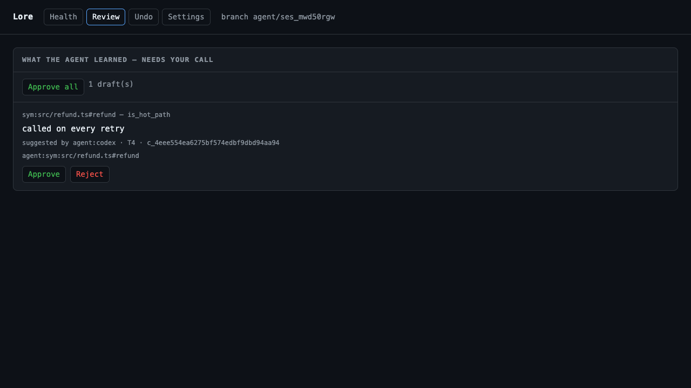
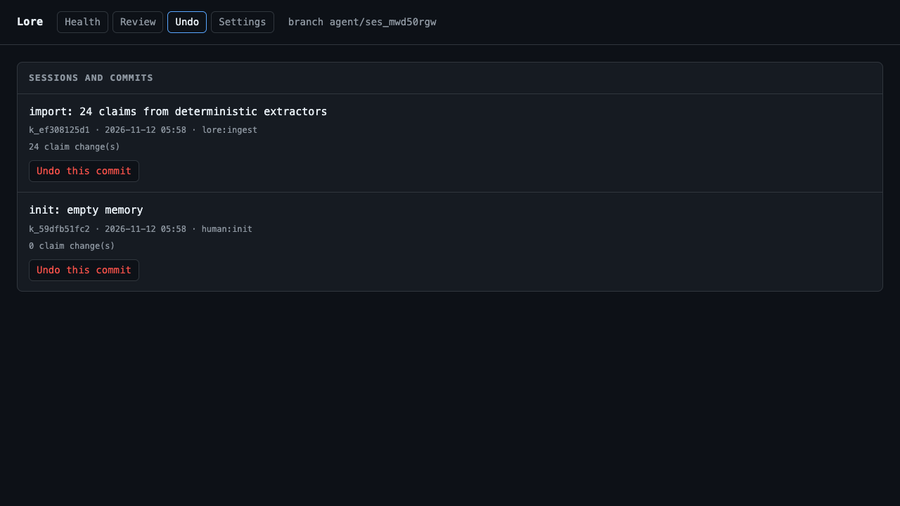

# Dashboard

```bash
lore ui            # http://127.0.0.1:4173
lore ui --open     # open the browser
lore ui --port 0   # pick a free port
```


Four tabs: **Health**, **Review**, **Undo**, **Settings**. It reads the same `.lore/lore.db` the CLI
uses, so the page is live and needs no export step. Review and Undo write through `src/actions.ts`, so
policy is enforced exactly as it is in the CLI.





## What it shows

| Panel | Source |
|---|---|
| active / draft / stale / ahead / conflicts | claim states, `claimFreshness`, `merge_conflict` |
| claims | `claim` joined with freshness; filters: text, state, freshness |
| recent commits | `memory_commit`, with a `merge` marker when a second parent exists |

## Endpoints

| Path | Returns |
|---|---|
| `GET /` | the page |
| `GET /api/health` | counters, branch, remote label |
| `GET /api/claims?q=&status=&fresh=&limit=` | claim rows with freshness |
| `GET /api/commits` | last 50 commits |
| `GET /api/conflicts` | unresolved merge conflicts |
| `GET /api/identity` | principal, role, team mode, policy, remote |
| `POST /api/approve` | `{ ids }` — approve drafts |
| `POST /api/reject` | `{ claim, reason }` — retract a draft |
| `POST /api/revert` | `{ commit }` — inverse commit |
| `POST /api/attest` | `{ claim, verdict, reason }` — independent review |

Writes require the `x-lore-csrf` header (token injected into the page) and an `Origin` that matches the
bound host; anything else is 403. Unknown writes return 403 before routing. MCP has no dashboard tool.

## Security

- Binds `127.0.0.1` by default. `--host 0.0.0.0` prints a warning: the dashboard has no authentication
  and exposes memory content to the network.
- Claim text is rendered with `textContent`, never `innerHTML`; memory can contain untrusted input.

## Limits

- No redact or purge from the UI; those stay CLI-only on purpose.
- No per-claim history; use `lore blame` for that.
- No charts; counters, cards and tables only.
- Desktop packaging is #66; this is the web app it will wrap.
