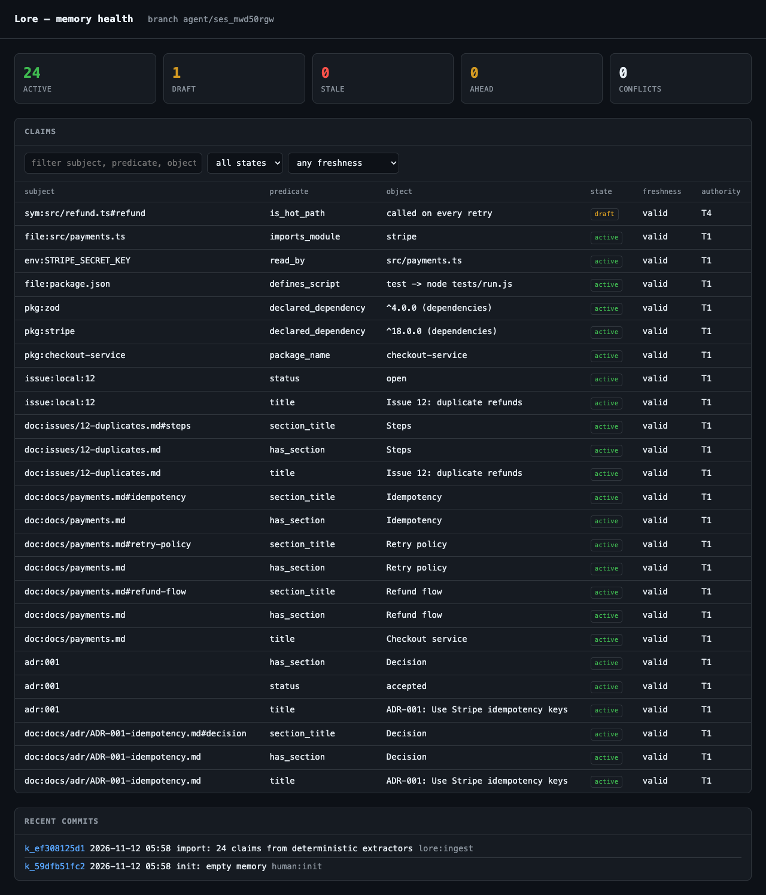
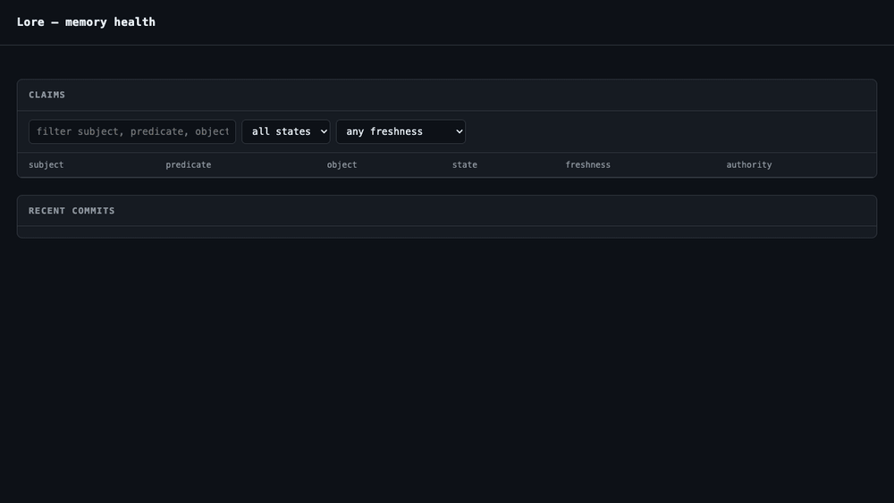

# Dashboard

```bash
lore ui            # http://127.0.0.1:4173
lore ui --open     # open the browser
lore ui --port 0   # pick a free port
```





Read-only by design: health counters, a filterable claim table, and the recent commit list. It reads
the same `.lore/lore.db` the CLI uses, so the page is live and needs no export step.

## What it shows

| Panel | Source |
|---|---|
| active / draft / stale / ahead / conflicts | claim states, `claimFreshness`, `merge_conflict` |
| claims | `claim` joined with freshness; filters: text, state, freshness |
| recent commits | `memory_commit`, with a `merge` marker when a second parent exists |

## Endpoints

| Path | Returns |
|---|---|
| `GET /` | the page |
| `GET /api/health` | counters, branch, remote label |
| `GET /api/claims?q=&status=&fresh=&limit=` | claim rows with freshness |
| `GET /api/commits` | last 50 commits |
| `GET /api/conflicts` | unresolved merge conflicts |

Every non-GET request returns 405. There is no write path, and MCP has no dashboard tool.

## Security

- Binds `127.0.0.1` by default. `--host 0.0.0.0` prints a warning: the dashboard has no authentication
  and exposes memory content to the network.
- Claim text is rendered with `textContent`, never `innerHTML`; memory can contain untrusted input.

## Limits

- Read-only: no approve, redact or undo. Those arrive with the desktop shell (#21).
- No history view per claim; use `lore blame` for that.
- No charts; counters and tables only.
