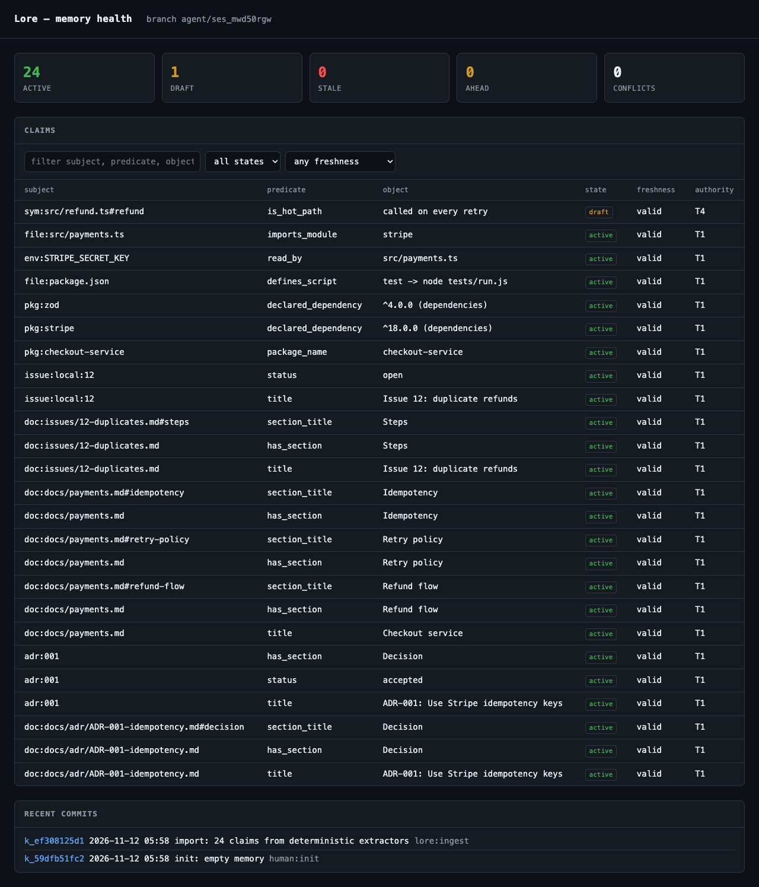
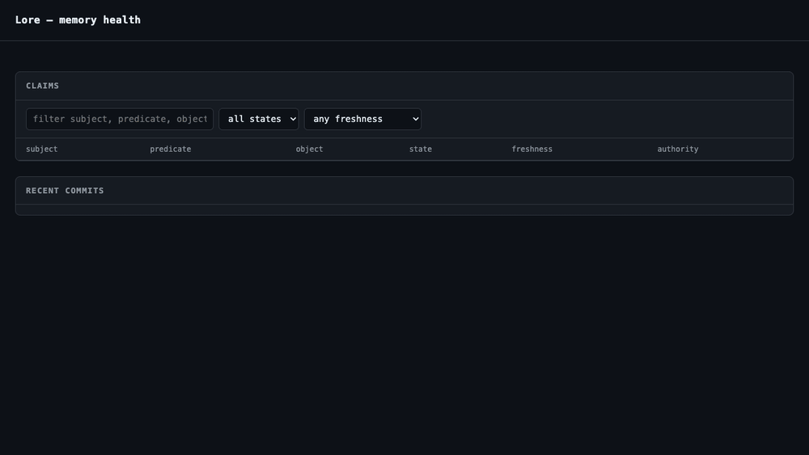
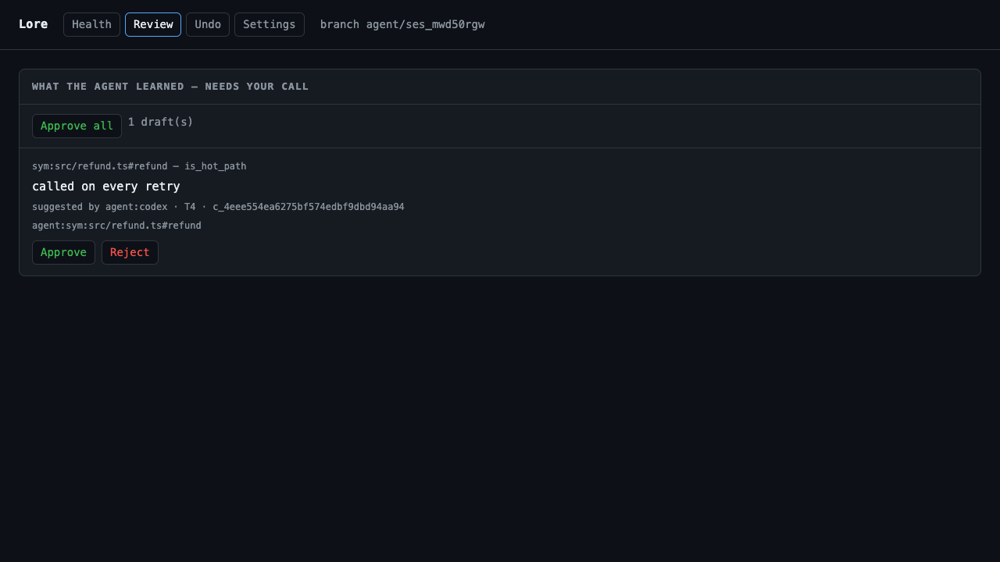
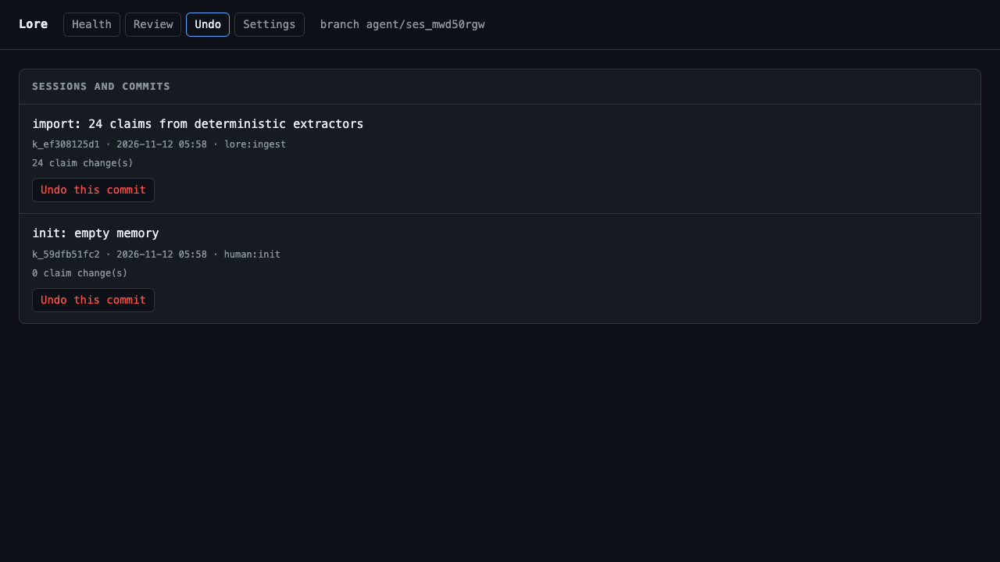

# Dashboard

```bash
lore ui            # http://127.0.0.1:4173
lore ui --open     # open the browser
lore ui --port 0   # pick a free port
```





Six tabs: **Knowledge Hub**, **Review**, **Conflicts**, **Undo**, **Ontology**, **Settings**. It reads the same `.lore/lore.db` the CLI
uses, so the page is live and needs no export step. Review, Undo, Claim authoring and Supersede write through
the same model and action policies as the CLI.





## What it shows

| Panel | Source |
|---|---|
| active / draft / stale / ahead / conflicts | claim states, `claimFreshness`, open `claim_conflict` + `merge_conflict` rows |
| knowledge categories | filtered by Architecture, Env, Routes, Dependencies, Inferences |
| claims search and pagination | server-side `q`/`status`/`fresh`/`offset` over `/api/claims`; the header shows loaded/total and Load more |
| claims view modes | Entity Dossier (grouped by entity with bulleted facts, freshness tags, and quick-add actions), structured Cards, interactive Graph explorer (degree-scaled physics layout, auto-fitting bounds, collision-culled labels, cluster badges, node-type legend, package filtering, node inspector drawer, pan/zoom), raw Triples table with a sticky action column |
| conflicts | side-by-side tier-1 and merge conflicts with Keep left/right and Take ours/theirs/both actions that run the existing resolve and merge planning code |
| ontology inspector | `lore.ontology.yml` rules, cardinalities, TTLs, authority ladder |
| recent commits | `memory_commit`, with a `merge` marker when a second parent exists |

## Endpoints

| Path | Returns |
|---|---|
| `GET /` | the page |
| `GET /favicon.svg` | Lore brand icon SVG |
| `GET /favicon.ico` | brand favicon icon |
| `GET /api/health` | counters, branch, remote label, open tier-1 and merge conflicts |
| `GET /api/entities` | distinct active entities with types and display labels |
| `GET /api/claims?q=&status=&fresh=&limit=&offset=` | `{ claims, total, offset, limit }` with freshness and draft origin branch |
| `GET /api/claim-details?id=` | full claim explanation, live code snippet, human summary |
| `GET /api/commits` | last 50 commits |
| `GET /api/conflicts` | `{ claim, merge, total }` open conflicts with both sides |
| `GET /api/identity` | principal, role, team mode, policy, remote |
| `GET /api/ontology` | active ontology rules from `lore.ontology.yml` |
| `GET /api/repo/recent` | current repository and recently opened repositories |
| `POST /api/approve` | `{ ids }` — approve drafts on each draft's origin branch |
| `POST /api/reject` | `{ claim, reason }` — retract a draft on its origin branch |
| `POST /api/revert` | `{ commit }` — inverse commit |
| `POST /api/attest` | `{ claim, verdict, reason }` — independent review |
| `POST /api/claim` | `{ subject, predicate, object }` — record a new human fact |
| `POST /api/supersede` | `{ claim, object }` — supersede an existing claim with new text |
| `POST /api/conflicts/resolve` | `{ kind, id, take }` — resolve a tier-1 (`ours`/`theirs`) or merge (`ours`/`theirs`/`both`) conflict |
| `POST /api/repo/switch` | `{ path }` — switch the active store |
| `POST /api/repo/browse` | explicit OS folder picker; only called by the modal's Browse OS button |

Writes require the `x-lore-csrf` header (token injected into the page) and an `Origin` that matches the
bound host; anything else is 403. Unknown writes return 403 before routing. MCP has no dashboard tool.

## Security

- Binds `127.0.0.1` by default. `--host 0.0.0.0` prints a warning: the dashboard has no authentication
  and exposes memory content to the network.
- Claim text is rendered with `textContent`, never `innerHTML`; memory can contain untrusted input.

## Limits

- No redact or purge from the UI; those stay CLI-only on purpose.
- No per-claim history; use `lore blame` for that.
- No charts; counters, cards and tables only.
- Desktop packaging is #66; this is the web app it will wrap.
